# JARVIS Live Web Search & Deep Retrieval Architecture

This document provides a comprehensive technical overview of the **Live Web Search & Deep RAG Retrieval Pipeline** in JARVIS, detailing the end-to-end flow, multi-provider racer, Crawl4AI extraction, distributed caching, hybrid BM25 + neural reranking, multi-source corroboration, domain trust tiers, multimodal media search grounding, and zero-hardcoding invariants.

---

## 1. High-Level Architecture Flow

```mermaid
flowchart TD
    UserQuery["User Input (Text or Multimodal Media Attachment)"] --> ModeCheck{"Web Search Opted?"}
    
    ModeCheck -->|User Toggle ON or Route Requires Live| RouteStage["1. Query Intent & Routing Classifier"]
    ModeCheck -->|No / Static Query| DirectModel["Standard LLM Reasoning (No Web Call)"]
    
    RouteStage --> SearchCacheCheck{"2. In-Memory & Edge Response Cache Hit?"}
    SearchCacheCheck -->|Cache Hit| ReturnCached["Return Cached Verified Synthesis (<50ms)"]
    
    SearchCacheCheck -->|Cache Miss| QueryPlanner["3. Temporal Query Planner & Entity Parsing"]
    QueryPlanner --> MultiProvider["4. Parallel Multi-Provider Search Racer"]
    
    subgraph MultiProvider["Parallel Multi-Provider Search Tier"]
        SearXNG["SearXNG Multi-Engine Racer"]
        DDG["DuckDuckGo HTML & Instant Answers"]
        WikiData["Wikidata / Wikipedia Infoboxes"]
        GoogleNews["Google News RSS (Real-Time Live Feed)"]
        YahooFin["Yahoo Finance Live Quotes"]
        GDELT["GDELT Global Event Stream"]
        ExaEngine["Exa Neural Search (when configured)"]
    end
    
    MultiProvider --> TrustRegistry["5. Domain Trust Registry & Scraper Filtering"]
    TrustRegistry --> EvidenceGate{"Explicit Evidence in Snippets?"}
    
    EvidenceGate -->|No / Shallow Snippet| Crawl4AI["6. Deep Page Crawler (Crawl4AI & Parallel DOM Extraction)"]
    Crawl4AI --> ParentChild["Parent-Child Hierarchical Chunking"]
    
    EvidenceGate -->|Yes| ParentChild
    ParentChild --> HybridRank["7. Hybrid BM25 & Semantic Neural Reranker (NVIDIA NeMo)"]
    HybridRank --> Corroboration["8. Multi-Source Corroboration Engine"]
    
    Corroboration --> TemporalCheck["9. Temporal Succession & Fact Verification"]
    TemporalCheck --> RAGTriad["10. RAG Triad Evaluator (Context + Groundedness + Relevance)"]
    
    RAGTriad --> Synthesis{"Passes Verification Threshold?"}
    Synthesis -->|Yes| GroundedLLM["11. Grounded LLM Synthesis (Groq GPT OSS 120B / Gemini 2.5 Flash)"]
    Synthesis -->|No| FailClosed["Clean Refusal: 'I couldn't verify from reliable live sources.'"]
    
    GroundedLLM --> CacheStore["Store in Response Cache"]
    CacheStore --> FinalUI["12. Interactive Top Sources Carousel + Clean Natural Prose"]
```

---

## 2. Core Architectural Pillars

### A. Two-Tier Response & RAG Cache (`api/_lib/search-response-cache.js` & `distributed-cache.js`)
* **Canonical Query Hashing**: User queries are normalized (lowercased, punctuation-stripped, whitespace-compacted) and hashed via SHA-256 into deterministic cache keys (`buildSearchCacheKey`).
* **TTL-Governed Freshness**: Fast-changing queries (news, markets, sports) carry dynamic short TTLs (3–10 minutes), while encyclopedic/factual topics use bounded TTLs (up to 60 minutes).
* **Distributed Memory Fallback**: Integrates with edge memory caches to prevent redundant external search calls for identical or near-identical concurrent user requests.

### B. Free-Live Multi-Provider Racer (`api/_lib/free-live/providers.js`)
* **Parallel Competitive Dispatch**: Queries are dispatched concurrently across independent search engines:
  * **SearXNG Racer (`searchSearXNGRacer`)**: Queries randomized, high-availability public SearXNG instances with sub-second timeout cutoffs.
  * **DuckDuckGo HTML (`searchDuckDuckGoHtml`)**: Scrapes non-JavaScript HTML SERPs for reliable, unblocked results without API key dependencies.
  * **Wikipedia REST & Wikidata Infoboxes (`fetchWikipediaInfobox`)**: Fetches canonical structured claim data (`P35`, `P6`, `P169`, `P39`) directly from Wikidata and Wikipedia summaries.
  * **Yahoo Finance Live (`searchYahooFinanceQuotes`)**: Dedicated financial provider for real-time tickers, prices, and percentage changes.
  * **Google News RSS & GDELT**: Real-time breaking news feeds with sub-minute timestamp metadata.
* **First-To-Corroborate Wins**: The racer gathers the fastest pool of candidate URLs within strict latency budgets (2,000ms–3,500ms).

### C. Deep Extraction via Crawl4AI & Article Parsers (`api/_lib/crawl4ai-client.js`)
* When search snippets are too brief or clickbait-laden, JARVIS triggers the **Deep Page Crawler**:
  * **Crawl4AI Integration**: Sends URLs to high-performance headless rendering instances to extract clean Markdown, bypass client-side rendering traps, and isolate substantive article copy.
  * **DOM Hygiene**: Strips advertising sidebars, cookie banners, navigation menus, social share widgets, and footers.
  * **Metadata Extraction**: Extracts `<meta property="article:published_time">`, OpenGraph dates, and JSON-LD `dateModified` schemas for rigorous temporal anchoring.

### D. Parent-Child Hierarchical Chunking (`api/_lib/parent-child-chunker.js`)
* Large web pages are segmented into small **Child Chunks** (150–300 tokens) for precise lexical and semantic matching.
* When a child chunk matches query criteria, it automatically expands to its **Parent Chunk** (600–1,200 tokens) during LLM synthesis, providing the model with macroscopic context and eliminating hallucinated quote fragments.

### E. Hybrid BM25 & Semantic Neural Reranking (`api/_lib/hybrid-reranker.js` & `embeddings.js`)
* **Lexical Scoring (BM25)**: Evaluates exact entity keyword frequency, inverse document frequency, and term saturation.
* **Dense Semantic Embeddings**: When NVIDIA NeMo API keys are available, runs dense vector similarity matching (`rankTextsByEmbedding`, `rerankTexts`).
* **Temporal Decay Weighting (`computeTemporalScore`)**: Recent publications receive positive weight adjustments for breaking queries, while penalizing outdated reports that contradict newer updates.
* **Blended Score**: `FinalScore = (0.45 * BM25) + (0.40 * SemanticSimilarity) + (0.15 * TemporalFreshness) + DomainTrustDelta`.

### F. Domain Trust Registry & Scraper Suppression (`api/_lib/domain-trust-registry.js`)
* **Tier-1 Global Wire Services**: AP News, Reuters, AFP, BBC, UN, WHO, IMF receive base trust prioritization due to global bureau coverage.
* **Scraper & Content Farm Blocklist (`isScraperOrContentFarm`)**: Domain blacklist suppresses SEO clickbait farms, content scrapers, AI-generated rehash sites, and automated translation mirrors.
* **Domain Diversity Enforcement**: Search candidate sets must span at least 2 distinct domain owners to prevent single-source echo chambers.

### G. Multi-Source Corroboration Engine (`api/_lib/multi-source-corroboration.js`)
* A factual assertion (e.g. leadership changes, sporting outcomes, corporate acquisitions) must be corroborated across **multiple independent publishers**.
* The engine evaluates claim overlaps and applies a corroboration boost (`corroborationScoreDelta`) when 2+ tier-1 or tier-2 outlets independently confirm the same factual statement.

### H. Multimodal Media Upload Grounding + Live Web Verification
* When a user uploads an attachment (image, document, receipt, chart) AND enables live web search (via UI toggle, voice, or prompt):
  * **Dual Evidence Fusion**: Extracts visual features/OCR from the attachment while simultaneously querying live web sources using the user's prompt or extracted OCR entities.
  * **Unified Prompting**: Injects verified external web sources alongside raw image grounding tensors into Gemini/Groq multimodal synthesis.
  * **Interactive Source Presentation**: Automatically renders the top verified sources carousel (`🌐 SOURCES`) alongside the multimodal response, with clickable links and domain badges.

---

## 3. Zero-Hardcoding Invariant

JARVIS operates under a strict **Zero-Hardcoding Guarantee**:
* **No static entity dictionaries, sports team lists, election catalogs, or canned answer tables exist anywhere in the codebase.**
* All acronyms, corporate entities, government offices, and real-time events are resolved **100% dynamically** at runtime via live search and public knowledge graphs.
* **Automated Hygiene Scanner (`tools/hardcoded-content-scanner.mjs`)**: Scans all 169+ codebase files during continuous testing (`npm run test:hygiene`) to enforce zero static factual tables or canned answer dictionaries.

---

## 4. Grounded Synthesis & Fail-Closed Guardrails

1. **Constrained Prompting**:
   The synthesis models (Groq GPT OSS 120B with failover to Google Gemini 2.5 Flash) receive strictly bounded, pre-ranked evidence blocks.
2. **Clean Prose (No Raw In-Text Citations)**:
   The synthesis prompt forbids bracket citation tokens (e.g. `[1]`, `[2]`, `(Source 1)`). All facts are synthesized into fluent, natural language.
3. **Clean Refusal on Insufficient Evidence**:
   If evidence fails the RAG Triad Evaluator or lacks cross-source corroboration, JARVIS fails closed:
   `"I couldn't verify the current information from reliable live sources."`
4. **Top Interactive Sources Carousel (`🌐 SOURCES (X VERIFIED)`)**:
   Renders at the top of the chat bubble with publisher favicons, domain labels, verified numbering badges, and direct links.

---

## 5. Verification & Test Suite

The live search and RAG architecture is validated across **82 automated test suites** (`npm test`):
* `test:api`: API contracts, live RAG synthesis, Exa fallback, and streaming SSE.
* `test:deterministic`: Fast-path deterministic fact verifiers and routing invariants.
* `test:verification`: Entity verifiers, temporal claim validation, and tool dispatchers.
* `test:hygiene`: Security audit, clean DOM standards, and 0-hardcoded content verification across 169+ files.
