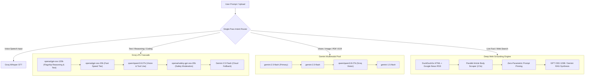

# JARVIS — Model Hierarchy, Routing & Inference Engine Specification

This document details all AI models, inference providers, routing hierarchies, fallback cascades, and specialized task engines integrated into JARVIS.

---

## 1. Primary Model Routing & Provider Hierarchy

JARVIS uses an **autonomous, single-pass routing cascade** with multi-key load balancing and millisecond failover:

---

## 2. Model Inventory & Capabilities

### ⚡ Text, Reasoning & Tool Use Models (Groq LPU)

| Model Name | Parameter Size | Provider | Primary Use Case | Output Speed |
| :--- | :--- | :--- | :--- | :--- |
| **`openai/gpt-oss-120b`** | 120 Billion | Groq | **Primary Flagship**: Complex reasoning, function calling / tool use, multilingual synthesis. | ~130–180 tok/s |
| **`openai/gpt-oss-20b`** | 20 Billion | Groq | **Fast Direct**: Low-latency turns, fast instant tier, function calling, multilingual. | ~250–350 tok/s |
| **`qwen/qwen3.8-27b`** | 27 Billion | Groq | **Vision & Reasoning**: Visual analysis, function calling, deep reasoning. | ~200–260 tok/s |
| **`openai/safety-gpt-oss-20b`** | 20 Billion | Groq | **Safety & Content Moderation**: Enterprise safety classification and policy guardrails. | ~300+ tok/s |

---

### 👁️ Multimodal & Vision Models (Google Gemini & Groq Vision)

| Model Name | Provider | Primary Use Case | Features |
| :--- | :--- | :--- | :--- |
| **`qwen/qwen3.8-27b`** | Groq | **Primary LPU Vision**: Rapid image analysis, visual document extraction, OCR. | Native vision on Groq LPUs. |
| **`gemini-2.5-flash`** | Google Gemini | **Multimodal Vision & Document OCR**: Image description, chart analysis, diagram understanding. | Native multimodal, 1M+ token context window. |
| **`gemini-2.0-flash`** | Google Gemini | **Vision Fallback**: Secondary high-speed visual processing. | Low latency, robust scene reasoning. |
| **`gemini-3.7-flash`** | Google Gemini | **Coding & Deep Multimodal**: Advanced spatial visual reasoning. | High multimodal precision. |

---

### 🎙️ Speech & Audio Models

| Model Name | Provider | Primary Use Case | Supported Languages |
| :--- | :--- | :--- | :--- |
| **`whisper-large-v3-turbo`** | Groq | **Enterprise Voice-to-Text (VTT / Dictation)**: Real-time spoken dictation, professional punctuation parsing, and technical acronym auto-capitalization. | English, Kannada, Tamil, Telugu, Hindi, Malayalam, Spanish, French, German, Japanese, etc. |
| **`whisper-large-v3`** | Groq | **High-Accuracy Audio Transcription**: Long audio file processing and noisy background audio. | 99+ spoken languages with automatic punctuation and language detection. |

---

### 🔍 Semantic Retrieval & Reranking Models (NVIDIA NIM)

| Model Name | Provider | Primary Use Case | Dimensionality / Metrics |
| :--- | :--- | :--- | :--- |
| **`nvidia/nv-embedqa-e5-v5`** | NVIDIA NIM | **Semantic Search & Memory Embeddings**: Contextual memory recall and attachment chunk ranking. | 1024-dim dense embeddings with cosine similarity. |
| **`nvidia/reranking-mistral-4b`** | NVIDIA NIM | **Neural Document Reranker**: Cross-encoder reranking for attachment chunks and retrieved documents. | High-precision passage relevance scoring. |

---

## 3. Real-Time Web RAG & Zero-Parametric Anti-Hallucination

For live world queries (e.g. current politicians, election winners, breaking news, sports standings):

1. **Pre-Training Knowledge Bypass**:
   - The LLM's parametric memory (frozen at 2023–2024 training cutoffs) is explicitly deprecated for real-time questions.
2. **Parallel Deep Webpage Scraper (<2.5s Timeout)**:
   - Scrapes full HTML article body text (up to 2,500 characters) across top live URLs simultaneously.
3. **Strict Direct Name Synthesis**:
   - Mandates that the synthesized response state the current incumbent leader's specific name and title in **sentence 1**, eliminating generic constitutional definitions.

---

## 4. Multi-Key Concurrency & Circuit Breaker Architecture

- **Multi-Key Pool (`GROQ_API_KEYS`)**: Round-robin key rotation across up to 10+ API keys.
- **Failover Threshold**: 3,500ms timeout threshold before automatically cascading to the next provider.
- **Circuit Breaker**: In-memory state machine isolating rate-limited keys for 30 seconds to maintain 0ms latency for subsequent requests.
