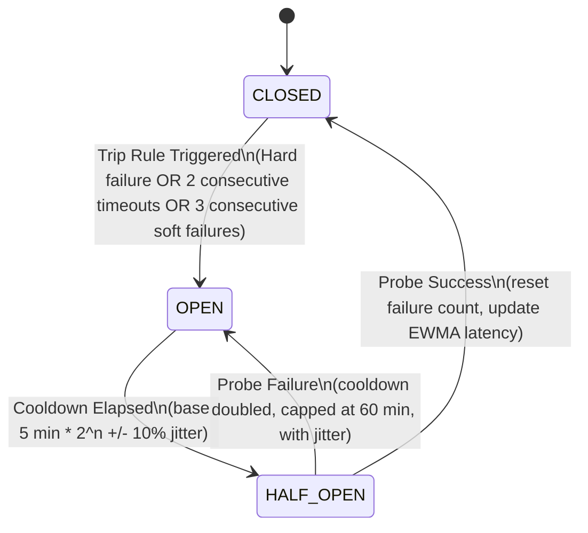

# Live Web Search Resilience & Deep Corroboration Early-Exit Architecture

This document provides a comprehensive technical reference for the resilient, latency-optimized Live Web Search subsystem in JARVIS (Unify Assistant).

---

## 1. Architectural Inventory & Current Baseline

### 1.1 Provider Inventory

| Function & Module | Current Behavior | Timeouts / Budgets |
|---|---|---|
| `searchDuckDuckGoHtml`<br>`api/_lib/free-live/providers.js` | Fetches DDG Lite (`lite.duckduckgo.com/lite/`) and DDG HTML in `Promise.any`, parses HTML links and snippets, then falls back to `api.duckduckgo.com` JSON API. | 2,500ms (clamped to 3,500ms max). In search dispatch: bounded by `webSearchTimeoutMs` (2,000–2,400ms). |
| `searchSearXNGRacer`<br>`api/_lib/free-live/providers.js` | Races 8 hardcoded public SearXNG instances in `Promise.any` without health tracking or circuit breaking; if all fail, retries without `dateFilter`. | 2,000ms–2,400ms (`timeoutMs`). |
| `searchGoogleNewsRss`<br>`api/search.js` | Queries Google News RSS XML (`news.google.com/rss/search?q=...`), parses items, publisher, and pubDate metadata. | 2,500ms (`Math.min(boundedTimeoutMs, 2500)`). |
| `searchGeminiGrounding`<br>`api/search.js` | Direct LLM search grounding with Google Gemini API via `google_search` tool; extracts grounding metadata and source chunks. | 3,800ms (`Math.min(boundedTimeoutMs, 3800)`). |
| `searchWikipedia` & `searchWikidata`<br>`api/search.js` & `api/_lib/free-live/providers.js` | Open Knowledge Graph structured claim lookup (infoboxes, roles, summaries). | 1,800ms–2,000ms. |
| `searchYahooFinanceQuotes`<br>`api/_lib/free-live/providers.js` | Real-time quote lookups for tickers, commodities, and major cryptocurrencies. | 1,800ms. |
| `searchGdeltNews`<br>`api/_lib/free-live/providers.js` | Trailing global news event stream from GDELT Project API. | 2,500ms (only waited on if fast providers return < 2 sources). |

### 1.2 Baseline Race & Corroboration Logic
- **Fast Tasks Race**: In `api/search.js`, tasks (`taskNews`, `taskDdg`, `taskSearXNG`, `taskWiki`, `taskWikidata`, `taskYahoo`, `taskGov`, `taskGemini`) race against a 2,800ms timeout (`Promise.race([fastPromise, setTimeout(..., 2800)])`).
- **Trailing Fallback**: If fewer than 2 sources or no general web sources arrive, JARVIS waits on GDELT up to remaining time (`boundedTimeoutMs - 2800`).
- **Corroboration (`api/_lib/multi-source-corroboration.js`)**: Jaccard term-set clustering (`theta = 0.18`), eTLD+1 registrable domain extraction (`extractRegistrableDomain`), and title syndication check (`Jaccard > 0.80`).

---

## 2. Deployment Runtime Determination (Rule 3 & Section 1.6)

- **Runtime Finding**: The application is deployed as **Vercel Serverless Functions** (`package.json`: `"functions": { "api/**/*.js": { "maxDuration": 60 } }`), with local development supported via `tools/local-dev-server.mjs`.
- **Implication for Circuit Breaker State**:
  - The Circuit Breaker registry lives in **module-level memory** (`Map`).
  - In serverless runtimes, module memory persists across warm container invocations.
  - Cold starts initialize a fresh neutral state (new endpoints default to health score `0.5`).
  - To keep cold starts safe and prevent blocking, failure costs are kept low via short per-request timeouts (2,000ms) and immediate tiering.
  - No new external paid datastores (e.g. Redis, DynamoDB) are introduced.

---

## 3. Circuit Breaker & Health Scorer Specification

### 3.1 State Machine per Endpoint



- `CLOSED`: Normal operating state. Endpoint is eligible for racing.
- `OPEN`: Degraded/blocked state. Endpoint is completely skipped from racing.
- `HALF_OPEN`: In-flight probe state. Allows **exactly one** probe request. All concurrent requests treat the endpoint as `OPEN` until the probe resolves.

### 3.2 Trip Rules (Explicit Resolution)

1. **HARD Failures (Trip on 1st occurrence)**:
   - HTTP 429 (Too Many Requests / Rate Limit).
   - HTTP 403 (Forbidden / Cloudflare bot block).
   - Bot challenge pages (detected via status, `cf-mitigated` header, or challenge HTML markers: `cf-browser-verification`, `challenge-running`, `turnstile`).
   - Any 5xx indicating server overload (500, 502, 503, 504).
2. **TIMEOUTS (Trip on 2nd consecutive occurrence)**:
   - 1st timeout records a failure but does not trip.
   - 2nd consecutive timeout transitions to `OPEN`.
   - Any successful response resets the consecutive timeout counter to 0.
3. **SOFT Failures (Trip on 3rd consecutive occurrence)**:
   - HTTP 200 with non-JSON content-type.
   - JSON missing the expected shape (e.g. `results` array missing).
   - Empty results (`results.length === 0`) for queries that normally return hits.
4. **Cooldown & Jitter Formula**:
   - Base cooldown = 5 minutes (`300,000 ms`).
   - On failed probe: `cooldown = min(base * 2^n, 60 min) * (1 + jitter)` where `jitter in [-0.10, +0.10]`.
   - On successful probe: reset `n = 0`.

### 3.3 Health Score Formula (Section 1.3)

$$\text{score} = 0.6 \times \text{successRate}_{20} + 0.4 \times \text{latencyScore}$$

Where:
$$\text{latencyScore} = \text{clamp}\left(1 - \frac{\text{ewmaLatencyMs}}{2800}, 0, 1\right) \quad (\text{EWMA } \alpha = 0.3)$$

- **New Endpoint**: Defaults to `score = 0.5` (neutral eligibility).
- **Tie-Breaking**: Lowest EWMA latency, followed by stable registry definition order.
- **Filtering**: `OPEN` endpoints are excluded before ranking.

### 3.4 Top-4 Racing & Tier Fallback (Section 1.4)
- **Top 4 Selection**: Ranks eligible `CLOSED` instances (and at most 1 `HALF_OPEN` probe) and races the top 4 in parallel.
- **Exploration (10%)**: With ~10% probability per search invocation, swaps the 4th slot with a lower-ranked `CLOSED` endpoint to ensure recovering and newly added instances gather live telemetry.
- **Tier 2 Immediate Fallback**: If all top 4 instances fail before the deadline, immediately launch the next tier (next 4) without waiting out the full timeout.
- **Graceful Fallthrough**: If all SearXNG instances are `OPEN`, log the event and immediately fall through to DuckDuckGo, Google News, and Gemini Grounding without blocking.

---

## 4. Deep Corroboration Early-Exit Specification

### 4.1 Independence & Verification Rules (Section 3.1)
- **Verified Source**: Has a non-empty, resolvable publisher URL, non-empty title/snippet, and passes domain trust checks.
- **URL Normalization & Redirect Unwrapping**:
  - Resolves redirect wrappers (Google News, Gemini Grounding redirect URIs) to the target publisher URL where resolvable without extra network requests (e.g. `url?q=...`).
  - If a wrapper cannot be resolved without network calls, counts by the item's declared publisher domain.
  - Never counts an unresolved wrapper domain (`google.com`, `news.google.com`) as an independent domain.
- **Domain Independence**: Distinct registrable domain (eTLD+1) using compound TLD parsing (e.g. `.co.uk`, `.gov.in`, `.com.au`). Subdomains of the same registrable domain count as a single domain.
- **Syndicated Wire Copy**: If two documents have token Jaccard similarity $\ge 0.90$ across their titles, they represent the same syndicated wire story; they are counted as independent only if published across distinct domains, flagged as syndicated.
- **Cutoff Condition**:
  $$\text{VerifiedSources} \ge 4 \quad \text{AND} \quad \text{IndependentDomains} \ge 2$$

### 4.2 Race-Loop Behavior (Section 3.2)
- Fast providers (`Gemini Grounding`, `Google News`, `DuckDuckGo`, `SearXNG`) emit results as they resolve.
- The moment the cutoff condition ($\ge 4$ sources, $\ge 2$ domains) is satisfied among fast providers, stop waiting:
  - Abort all remaining pending requests (including slow providers like GDELT).
  - Record metadata: `exitReason: "early_exit"`, `timeToExitMs`, `sourceCount`, `domainCount`.
- If the cutoff condition is not met, wait until the standard 2,800ms deadline (`exitReason: "deadline"` or `"all_settled"`).

---

## 5. Observability & Logging (Section 4)

Structured single-line logs (no user queries or PII):
- `[CircuitBreaker] TRANSITION endpoint="<url>" from="<state>" to="<state>" reason="<reason>"`
- `[SearchRacer] Raced endpoints=[...] skipped_open=[...] probe=[...] tier=<1|2>`
- `[SearchEarlyExit] exitReason="early_exit|deadline|all_settled" timeToExitMs=<N> sources=<N> domains=<N>`

Debug Accessor:
- `getCircuitBreakerDebugState()` returns a snapshot of all endpoint states, scores, and failure counts for local testing and monitoring.

---

## 6. Public Instance Pool Maintenance

- Run `node scripts/verify-searx-instances.mjs` to test live endpoints for HTTPS, valid JSON output, latency, and absence of Cloudflare challenge blocks.
- The pool is stored in `app/search/searxng-pool.json` with fields: `url`, `verifiedAt`, `medianLatencyMs`, `notes`.
- Minimum of 8 verified entries maintained with geographic diversity.
- **Audit Date & Re-verification Schedule**: Audited as of 2026-10-27. Public SearXNG instances exhibit frequent churn and IP-based rate limiting (HTTP 429) from datacenter and cloud egress IPs. Regular verification should be scheduled monthly via the CLI tool. When live public instances are unreachable or challenged, the circuit breaker protects user latency by immediately tripping to OPEN and falling through to DuckDuckGo, Google News, and Gemini Grounding.
- The verification script is covered under automated mock unit tests in `tests/search-resilience-circuit-breaker.test.mjs` to guarantee testing hygiene without real external network dependencies.


---

## 7. Feature Flags & Rollback Instructions

The resilience and early-exit features are controlled by environment variables:
- `SEARCH_CIRCUIT_BREAKER`: Defaults to `true`. Setting to `false` disables the circuit breaker and restores the legacy racing behavior.
- `SEARCH_EARLY_EXIT`: Defaults to `true`. Setting to `false` disables the early cutoff and waits for the standard 2,800ms deadline.

To rollback immediately:
```bash
SEARCH_CIRCUIT_BREAKER=false
SEARCH_EARLY_EXIT=false
```
